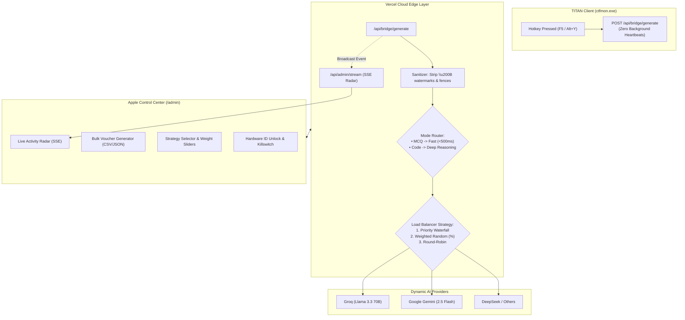

# Design: Advanced AI Brain Routing, Live Radar & Control Center Enhancements

## Architecture Overview



## Detailed Component Specifications

### 1. In-Memory SSE Event Bus (`/lib/events.ts` & `/api/admin/stream`)
- Implements a global event emitter for Vercel Serverless/Edge.
- When `/api/bridge/generate` finishes a query, it broadcasts `{ id, reg_key, mode, provider, model, latency_ms, tokens, timestamp }`.
- `/api/admin/stream` establishes a `text/event-stream` connection, sending keep-alive comments (`:\n\n`) every 15s and pushing JSON event frames.

### 2. Multi-Strategy Load Balancer (`/lib/brain.ts`)
- Config stored in `admin_config` or memory:
  - `routing_strategy`: `"waterfall" | "weighted" | "round_robin"`
  - `preferred_code_provider`: provider ID or `"auto"`
  - `preferred_mcq_provider`: provider ID or `"auto"`
- Supported strategies:
  1. **Waterfall**: Highest priority (`priority ASC`) first; cascade on error/rate-limit.
  2. **Weighted Random**: Accumulative weight picker based on `provider.weight` (1–100).
  3. **Round-Robin**: Atomic counter increment modulo active provider count.

### 3. Lightweight Sanitization (`/lib/sanitize.ts`)
- Inbound:
  ```typescript
  // Remove zero-width characters (watermark anti-cheat)
  text.replace(/[\u200B-\u200D\uFEFF\u2060\u200E\u200F]/g, "").trim()
  ```
- Outbound:
  - Strips leading/trailing markdown code fences (```java ... ```).
  - Removes common conversational preambles ("Here is the Java code:").

### 4. Bulk License Generator
- Generates N unique 8-digit keys (`/^\d{8}$/`).
- Inserts batch into `licenses` in a single transaction.
- Formats export:
  - Plain text copy (1 key per line)
  - CSV (`reg_key,expires_at,language,label`)
  - JSON
